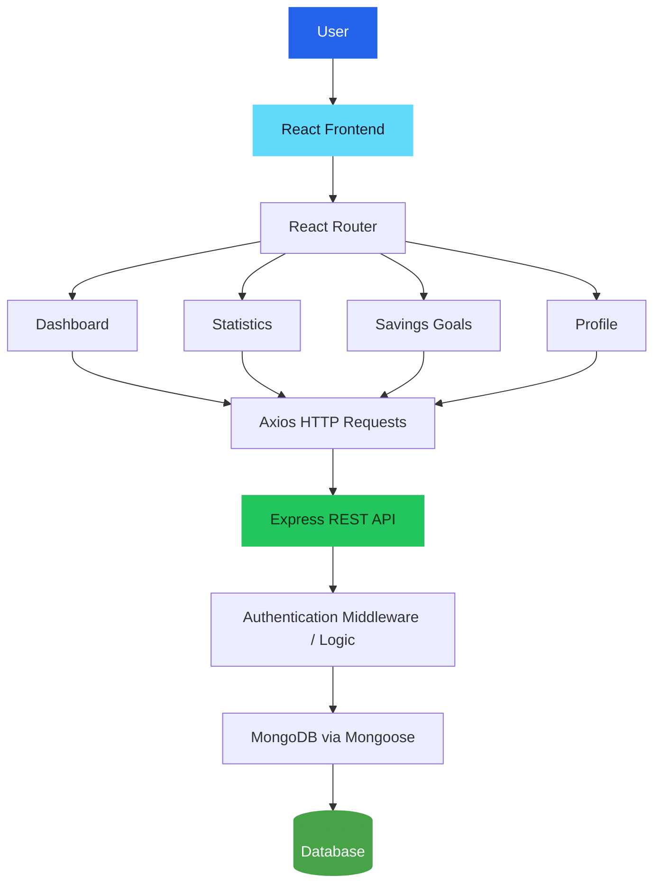

# 💰 FinTrack - Personal Finance Tracker

<p align="center">
  <strong>Take control of your money. Track smarter. Save better.</strong>
</p>

<p align="center">
  A full-stack personal finance management application designed to help users track transactions, visualize financial activity, and manage their savings goals through a clean and intuitive interface.
</p>

<p align="center">
  
  
  
  
  
</p>

<p align="center">
  <a href="https://github.com/Piyush-Gitkhg10/Personal-Finance-Tracker">Repository</a> •
  <a href="#-features">Features</a> •
  <a href="#-installation-and-setup">Installation</a> •
  <a href="#-project-structure">Project Structure</a>
</p>

---

## 📌 Overview

Managing personal finances becomes easier when income, expenses, spending patterns, and savings goals are organized in one place.

**FinTrack** is a full-stack web application built using the MERN stack. It provides an interactive dashboard for monitoring financial activity, dedicated statistics for understanding spending patterns, and a goals section for keeping savings targets organized.

The project demonstrates practical full-stack development concepts, including REST API integration, user authentication, database operations, protected routes, and interactive data visualization.

## ✨ Features

### 🔐 User Authentication

- User registration and login.
- Password hashing using `bcryptjs`.
- JSON Web Token (JWT)-based authentication.
- Protected application routes for authenticated users.

### 📊 Financial Dashboard

- A centralized view of financial activity.
- Visual summaries of transactions and financial information.
- An organized interface for reviewing personal finances.
- Convenient navigation between dashboard sections.

### 💳 Transaction Management

- Manage financial transactions through the application.
- Connect transaction data with the backend API.
- Persist transaction information in MongoDB.
- Organize financial records for easier tracking.

### 📈 Financial Statistics

- Dedicated statistics page for reviewing financial activity.
- Chart-based visualization using Chart.js and Recharts.
- Visual representation of financial data to make spending patterns easier to understand.

### 🎯 Savings Goals

- A dedicated section for managing savings goals.
- Backend API support for goal-related operations.
- A structured way to organize financial targets.

### 👤 Profile Management

- A dedicated profile page.
- Authentication-aware application navigation.
- Access to profile functionality within the protected application area.

### ⚡ Modern Application Architecture

- React Router for client-side navigation.
- Reusable React components and hooks.
- Express.js REST API.
- MongoDB integration using Mongoose.
- Axios for HTTP requests.
- Environment-based backend configuration.

## 🛠️ Tech Stack

| Technology       | Purpose                             |
| ---------------- | ----------------------------------- |
| React 18         | Frontend user interface             |
| React Router     | Client-side routing and navigation  |
| JavaScript       | Application logic                   |
| Axios            | HTTP communication with the backend |
| Chart.js         | Data visualization                  |
| React Chart.js 2 | React integration for Chart.js      |
| Recharts         | React-based charts                  |
| React Icons      | Interface icons                     |
| Node.js          | Backend JavaScript runtime          |
| Express.js       | REST API and server-side routing    |
| MongoDB          | NoSQL database                      |
| Mongoose         | MongoDB object modeling             |
| JWT              | Token-based authentication          |
| bcryptjs         | Password hashing                    |
| dotenv           | Environment variable management     |
| CORS             | Cross-origin request handling       |

## 🏗️ Application Architecture

The application follows a client-server architecture, with the React frontend communicating with the Express backend through HTTP requests.



### How It Works

1. Users register or log in through the React frontend.
2. The backend handles authentication and issues JWTs.
3. Protected frontend routes check the authentication state.
4. Axios sends requests to the Express API.
5. The backend processes requests and interacts with MongoDB through Mongoose.
6. The frontend displays the resulting financial information and visualizations.

## 📂 Project Structure

```text
Personal-Finance-Tracker/
│
├── client/
│   ├── public/
│   ├── src/
│   │   ├── components/
│   │   │   └── layout/
│   │   ├── hooks/
│   │   │   └── useAuth.js
│   │   ├── pages/
│   │   │   ├── Dashboard.js
│   │   │   ├── Statistics.js
│   │   │   ├── Goals.js
│   │   │   ├── Profile.js
│   │   │   ├── LoginPage.js
│   │   │   └── SignUpPage.js
│   │   └── App.js
│   └── package.json
│
├── server/
│   ├── routes/
│   │   ├── auth.js
│   │   ├── transactions.js
│   │   └── goals.js
│   ├── server.js
│   └── package.json
│
└── README.md
```

_Note: This is a simplified overview of the repository's main application files._

## 🚀 Installation and Setup

Follow these steps to run the application locally.

### Prerequisites

Make sure you have installed:

- [Node.js and npm](https://nodejs.org/)
- [MongoDB Community Server](https://www.mongodb.com/try/download/community) or access to a MongoDB Atlas cluster.
- [Git](https://git-scm.com/)

### 1. Clone the Repository

```bash
git clone https://github.com/Piyush-Gitkhg10/Personal-Finance-Tracker.git
cd Personal-Finance-Tracker
```

### 2. Configure the Backend

Navigate to the server directory and install dependencies:

```bash
cd server
npm install
```

Create a `.env` file inside the `server` directory:

```env
PORT=5001
MONGO_URI=your_mongodb_connection_string
JWT_SECRET=your_long_random_secret
```

Replace the placeholder values with your actual MongoDB connection string and a strong, randomly generated JWT secret.

**Security:** Never commit your `.env` file or expose database credentials and authentication secrets in your repository.

### 3. Start the Backend Server

From the `server` directory, run:

```bash
npm run dev
```

This command uses Nodemon to restart the server when files change.

Alternatively, start the server normally:

```bash
npm start
```

The backend defaults to port `5001`, unless overridden by your environment configuration.

### 4. Configure the Frontend

Open a second terminal and navigate to the project root:

```bash
cd client
npm install
```

The frontend's package configuration proxies development requests to:

```text
http://localhost:5001
```

Keep the backend running on that port unless you update the proxy configuration.

### 5. Start the Frontend

Inside the `client` directory, run:

```bash
npm start
```

The React development server will usually open at:

**http://localhost:3000**

Register an account or log in to explore the application.

## 🔑 Environment Variables

Configure the following backend variables in `server/.env`:

| Variable     | Description                                         |
| ------------ | --------------------------------------------------- |
| `PORT`       | Port used by the Express server; defaults to `5001` |
| `MONGO_URI`  | MongoDB connection string                           |
| `JWT_SECRET` | Secret used to sign and verify JWTs                 |

Ensure these names match the variables used by your backend code. Keep all secret values private.

## 🧪 Running the Application

For local development, use two terminal sessions.

**Terminal 1 — Backend**

```bash
cd server
npm run dev
```

**Terminal 2 — Frontend**

```bash
cd client
npm start
```

The frontend and backend run separately and communicate through HTTP requests.

## 👨‍💻 Author

**Piyush Kumar**

- GitHub: [@Piyush-Gitkhg10](https://github.com/Piyush-Gitkhg10)
- Project: [FinTrack - Personal Finance Tracker](https://github.com/Piyush-Gitkhg10/Personal-Finance-Tracker)
